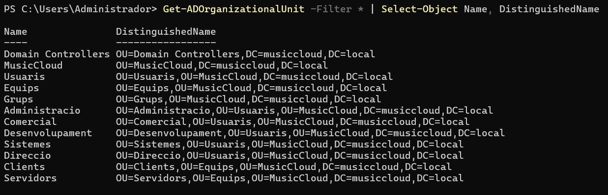

# Enunciat

## Objectiu

Crear l’estructura inicial d’unitats organitzatives del domini `musiccloud.local`.

## Escenari

MusicCloud ja disposa del domini:

```text
musiccloud.local
```

El servidor `SRV-AD-01` ja és controlador de domini.

Ara cal crear una estructura d’unitats organitzatives que permeti organitzar els objectes de l’empresa.

## Estructura que cal crear

Creeu l’estructura següent:

```text
musiccloud.local
└── MusicCloud
    ├── Usuaris
    │   ├── Administracio
    │   ├── Comercial
    │   ├── Desenvolupament
    │   ├── Sistemes
    │   └── Direccio
    ├── Equips
    │   ├── Clients
    │   └── Servidors
    └── Grups
```

## Part 1. Creació de la UO principal

Creeu una unitat organitzativa principal anomenada:

```text
MusicCloud
```

Aquesta UO serà el contenidor principal de l’estructura de l’empresa.

> New-ADOrganizationalUnit -Name "MusicCloud" -Path "DC=musiccloud,DC=local"

## Part 2. Creació de les UO de primer nivell

Dins de la UO `MusicCloud`, creeu les UO següents:

```text
Usuaris
Equips
Grups
```

> New-ADOrganizationalUnit -Name "Usuaris" -Path "OU=MusicCloud,DC=musiccloud,DC=local"

> New-ADOrganizationalUnit -Name "Equips" -Path "OU=MusicCloud,DC=musiccloud,DC=local"

> New-ADOrganizationalUnit -Name "Grups" -Path "OU=MusicCloud,DC=musiccloud,DC=local"

## Part 3. Creació de les UO de departaments

Dins de la UO `Usuaris`, creeu les UO següents:

```text
Administracio
Comercial
Desenvolupament
Sistemes
Direccio
```

> New-ADOrganizationalUnit -Name "Administracio" -Path "OU=Usuaris,OU=MusicCloud,DC=musiccloud,DC=local"

> New-ADOrganizationalUnit -Name "Comercial" -Path "OU=Usuaris,OU=MusicCloud,DC=musiccloud,DC=local"

> New-ADOrganizationalUnit -Name "Desenvolupament" -Path "OU=Usuaris,OU=MusicCloud,DC=musiccloud,DC=local"

> New-ADOrganizationalUnit -Name "Sistemes" -Path "OU=Usuaris,OU=MusicCloud,DC=musiccloud,DC=local"

> New-ADOrganizationalUnit -Name "Direccio" -Path "OU=Usuaris,OU=MusicCloud,DC=musiccloud,DC=local"

## Part 4. Creació de les UO d’equips

Dins de la UO `Equips`, creeu les UO següents:

```text
Clients
Servidors
```

> New-ADOrganizationalUnit -Name "Clients" -Path "OU=Equips,OU=MusicCloud,DC=musiccloud,DC=local"

> New-ADOrganizationalUnit -Name "Servidors" -Path "OU=Equips,OU=MusicCloud,DC=musiccloud,DC=local"

## Part 5. Verificació

Executeu una consulta que mostri totes les unitats organitzatives del domini.

La sortida ha de mostrar, com a mínim, les UO creades en aquesta pràctica.

> Get-ADOrganizationalUnit -Filter \* | Select-Object Name, DistinguishedName



## Part 6. Preguntes

Responeu breument:

1. Per què és útil crear una UO principal anomenada `MusicCloud`?

> És útil per tenir organitzada tota l'empresa sota una única OU.

2. Per què se separen `Usuaris`, `Equips` i `Grups`?

> Es separen per tenir una organització dels diferents tipus d'objectes de l'empresa.

3. Per què els departaments s’han creat dins de `Usuaris`?

> S'han creat dins d'Usuaris per tenir organitzats tots els usuaris per departaments i després sigui molt més fàcil localitzar-los. A més, fent això ens permet aplicar GPOs i administrar permisos.

4. Per què no és recomanable deixar tots els usuaris dins del contenidor `Users`?

> No és recomenable ja que seria més dificl l'administració i no podriem aplicar GPOs.

## Part 7. Creació scripts

- 7.1. Crea un script per eliminar totes les OUs creades en la pràctica
- 7.2. Crea un script que crei l'OU principal (musiccloud).
- 7.3. Crea un script que crei l'OU principal i les OUs descendents: Usuaris, Equips i Grups
- 7.4. Crea un script que creï l'OU principal si no existeix i que creï únicament les UO descendents que encara no existeixin. El script s'ha de poder executar més d'una vegada sense generar errors ni duplicar objectes.
